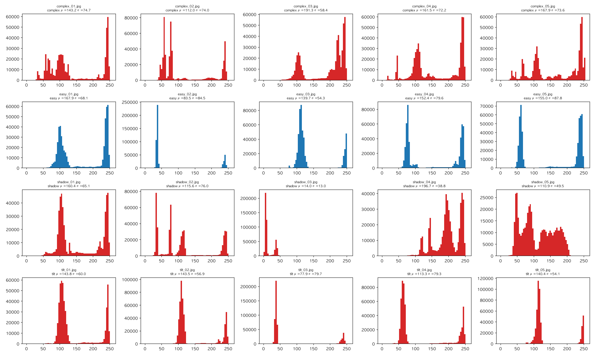
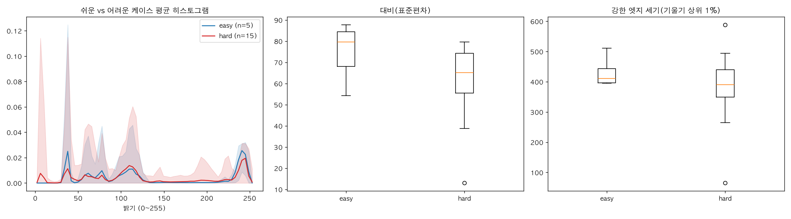
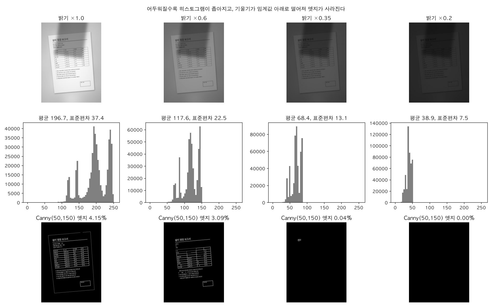

# 🟩 EDA 결과 (자동 생성)

## 🟢 1. 이미지별 밝기 통계

| 파일 | 조건 | 평균 | 표준편차 | 밝기 폭(p95-p5) | 어두운 비율 | 밝은 비율 | 강한 엣지(p99) |
| --- | --- | --- | --- | --- | --- | --- | --- |
| complex_01.jpg | complex | 143.2 | 74.7 | 192.0 | 0.105 | 0.319 | 425.9 |
| complex_02.jpg | complex | 112.0 | 74.0 | 194.0 | 0.305 | 0.214 | 589.0 |
| complex_03.jpg | complex | 191.3 | 58.4 | 151.0 | 0.001 | 0.523 | 494.5 |
| complex_04.jpg | complex | 161.5 | 72.2 | 202.0 | 0.085 | 0.397 | 470.5 |
| complex_05.jpg | complex | 167.9 | 73.6 | 203.0 | 0.059 | 0.426 | 440.9 |
| easy_01.jpg | easy | 167.9 | 68.1 | 158.0 | 0.001 | 0.445 | 443.3 |
| easy_02.jpg | easy | 83.5 | 84.5 | 209.0 | 0.758 | 0.215 | 394.7 |
| easy_03.jpg | easy | 139.7 | 54.3 | 149.0 | 0.001 | 0.2 | 396.1 |
| easy_04.jpg | easy | 152.4 | 79.6 | 178.0 | 0.002 | 0.42 | 411.1 |
| easy_05.jpg | easy | 155.0 | 87.8 | 193.0 | 0.193 | 0.491 | 511.1 |
| shadow_01.jpg | shadow | 160.4 | 65.1 | 155.0 | 0.01 | 0.356 | 390.2 |
| shadow_02.jpg | shadow | 115.6 | 76.0 | 212.0 | 0.264 | 0.231 | 410.6 |
| shadow_03.jpg | shadow | 14.0 | 13.0 | 36.0 | 1.0 | 0.0 | 65.0 |
| shadow_04.jpg | shadow | 196.7 | 38.8 | 126.0 | 0.001 | 0.313 | 368.2 |
| shadow_05.jpg | shadow | 110.9 | 49.5 | 147.0 | 0.205 | 0.0 | 264.9 |
| tilt_01.jpg | tilt | 143.8 | 60.0 | 153.0 | 0.001 | 0.253 | 342.4 |
| tilt_02.jpg | tilt | 143.5 | 56.9 | 146.0 | 0.0 | 0.238 | 295.7 |
| tilt_03.jpg | tilt | 77.9 | 79.7 | 209.0 | 0.789 | 0.185 | 358.3 |
| tilt_04.jpg | tilt | 113.3 | 79.3 | 192.0 | 0.192 | 0.256 | 438.0 |
| tilt_05.jpg | tilt | 140.4 | 54.1 | 147.0 | 0.0 | 0.2 | 355.6 |

## 🟢 2. 쉬운 vs 어려운 케이스

## 🟢 3. 어두운 이미지에서 엣지 검출이 어려운 이유 (실험 대상: shadow_04.jpg)

| 밝기 배율 | 평균 | 표준편차 | 기울기 p99 | 엣지 픽셀 비율 |
| --- | --- | --- | --- | --- |
| ×1.0 | 196.7 | 37.4 | 178.3 | 0.0415 |
| ×0.6 | 117.6 | 22.5 | 107.2 | 0.0309 |
| ×0.35 | 68.4 | 13.1 | 62.3 | 0.0004 |
| ×0.2 | 38.9 | 7.5 | 36.0 | 0.0 |

- 밝기를 f배 하면 픽셀 값 차이(= 기울기)도 f배가 된다. Canny 임계값은 고정이므로 기울기가 low/high 아래로 떨어진 경계는 사라진다.
- 히스토그램 관점: 분포가 0 근처로 몰리고 폭(표준편차)이 좁아진다 → 문서와 배경의 밝기 차이가 줄어든다.
- 어두운 영역은 센서 노이즈 비중이 커서(신호 대 잡음비 감소) 임계값을 낮추면 노이즈 엣지가 함께 늘어난다.

