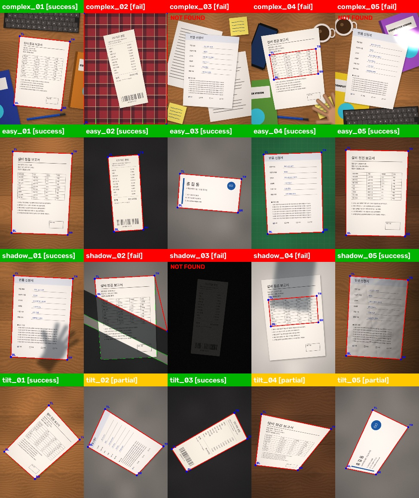

# 🟩 평가 결과 (자동 생성)

- 파라미터: `{'blur_kernel': 5, 'canny_low': 50, 'canny_high': 150, 'dilate_iter': 1, 'min_area_ratio': 0.1, 'approx_eps_ratios': [0.02, 0.03, 0.04, 0.05], 'process_height': 800, 'thresh_block': 21, 'thresh_c': 10, 'orientation': 'portrait'}`
- 성공 기준: 4꼭짓점 최대 오차 ≤ 대각선의 3% (정답 좌표가 있을 때 자동 판정)
- 부분 성공: 꼭짓점은 맞지만 종횡비가 실제 대비 5% 초과 차이
- 미검증(detected): 정답 좌표/수동 판정이 없어 '검출됨'만 확인된 상태

## 🟢 1. 조건(category)별 성공률

| 조건 | 테스트 수 | 성공 | 부분 성공 | 실패 | 미검증 | 성공률 |
| --- | --- | --- | --- | --- | --- | --- |
| 복잡한 배경 | 5 | 1 | 0 | 4 | 0 | 20% |
| 단순 배경 + 정면 | 5 | 5 | 0 | 0 | 0 | 100% |
| 그림자 있음 | 5 | 2 | 0 | 3 | 0 | 40% |
| 45도 이상 기울어짐 | 5 | 2 | 3 | 0 | 0 | 40% |
| **전체** | 20 | 10 | 3 | 7 | 0 | 50% |

## 🟢 2. 조명별 성공률

| 조명 | 테스트 수 | 성공 | 부분 성공 | 실패 | 미검증 | 성공률 |
| --- | --- | --- | --- | --- | --- | --- |
| dim | 1 | 0 | 0 | 1 | 0 | 0% |
| glare | 1 | 0 | 0 | 1 | 0 | 0% |
| shadow | 4 | 2 | 0 | 2 | 0 | 50% |
| uniform | 14 | 8 | 3 | 3 | 0 | 57% |
| **전체** | 20 | 10 | 3 | 7 | 0 | 50% |

## 🟢 3. 각도별 성공률

| 각도 | 테스트 수 | 성공 | 부분 성공 | 실패 | 미검증 | 성공률 |
| --- | --- | --- | --- | --- | --- | --- |
| front | 15 | 8 | 0 | 7 | 0 | 53% |
| tilt45+ | 5 | 2 | 3 | 0 | 0 | 40% |
| **전체** | 20 | 10 | 3 | 7 | 0 | 50% |

## 🟢 4. 배경별 성공률

| 배경 | 테스트 수 | 성공 | 부분 성공 | 실패 | 미검증 | 성공률 |
| --- | --- | --- | --- | --- | --- | --- |
| complex | 5 | 1 | 0 | 4 | 0 | 20% |
| simple | 15 | 9 | 3 | 3 | 0 | 60% |
| **전체** | 20 | 10 | 3 | 7 | 0 | 50% |

## 🟢 5. 이미지별 결과

| 파일 | 조건 | 상태 | 판정 | 꼭짓점 오차(대각선 비) | 종횡비 오차 | 큰 윤곽선 수 |
| --- | --- | --- | --- | --- | --- | --- |
| complex_01.jpg | complex | success | auto | 0.0016 | 0.0297 | 1 |
| complex_02.jpg | complex | fail | auto | 0.2833 |  | 1 |
| complex_03.jpg | complex | fail | auto |  |  | 0 |
| complex_04.jpg | complex | fail | auto | 0.2188 |  | 1 |
| complex_05.jpg | complex | fail | auto |  |  | 0 |
| easy_01.jpg | easy | success | auto | 0.0016 | 0.0297 | 1 |
| easy_02.jpg | easy | success | auto | 0.0014 | 0.0236 | 1 |
| easy_03.jpg | easy | success | auto | 0.0012 | 0.0122 | 1 |
| easy_04.jpg | easy | success | auto | 0.0014 | 0.0255 | 1 |
| easy_05.jpg | easy | success | auto | 0.0014 | 0.0283 | 1 |
| shadow_01.jpg | shadow | success | auto | 0.0012 | 0.0233 | 1 |
| shadow_02.jpg | shadow | fail | auto | 0.4562 |  | 2 |
| shadow_03.jpg | shadow | fail | auto |  |  | 0 |
| shadow_04.jpg | shadow | fail | auto | 0.2463 |  | 1 |
| shadow_05.jpg | shadow | success | auto | 0.0016 | 0.0283 | 1 |
| tilt_01.jpg | tilt | success | auto | 0.0034 | 0.0134 | 1 |
| tilt_02.jpg | tilt | partial | auto | 0.002 | 0.1789 | 1 |
| tilt_03.jpg | tilt | success | auto | 0.002 | 0.0028 | 1 |
| tilt_04.jpg | tilt | partial | auto | 0.0016 | 0.0502 | 1 |
| tilt_05.jpg | tilt | partial | auto | 0.0017 | 0.0961 | 1 |

## 🟢 6. 모아보기

