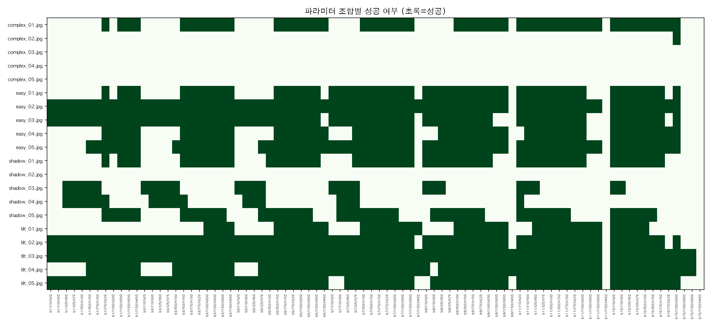

# 🟩 파라미터 스윕 결과 (자동 생성)

- 판정 방식: 정답 좌표 기반 (부분 성공 포함)
- 조합 수: 84 (blur [1, 3, 5, 7, 9, 11, 15] × low [10, 25, 50, 75, 100, 150] × high=low×[2, 3])

## 🟢 1. 모든 이미지에 통하는 단일 파라미터가 있는가?

- 최고 조합 `b15/l10/h30` 성공 14/20장 (70%)
- 모든 이미지 성공 조합 수: **0개**
- 어떤 조합으로도 성공 못한 이미지: complex_03.jpg, complex_04.jpg, complex_05.jpg, shadow_02.jpg

## 🟢 2. 성공 상위 10개 조합

| 순위 | 조합 | 성공 장수 | 성공률 |
| --- | --- | --- | --- |
| 1 | `b15/l10/h30` | 14 | 70% |
| 2 | `b15/l10/h20` | 14 | 70% |
| 3 | `b11/l25/h50` | 14 | 70% |
| 4 | `b7/l50/h150` | 13 | 65% |
| 5 | `b5/l75/h225` | 13 | 65% |
| 6 | `b5/l100/h200` | 13 | 65% |
| 7 | `b5/l100/h300` | 13 | 65% |
| 8 | `b15/l25/h50` | 13 | 65% |
| 9 | `b7/l25/h75` | 13 | 65% |
| 10 | `b7/l50/h100` | 13 | 65% |

## 🟢 3. 이미지별 성공 가능한 조합 수

| 파일 | 조건 | 성공 조합 수 | 예시 성공 조합 |
| --- | --- | --- | --- |
| complex_01.jpg | complex | 52/84 | b1/l75/h225, b1/l100/h300, b1/l150/h300 |
| complex_02.jpg | complex | 1/84 | b15/l100/h200 |
| complex_03.jpg | complex | 0/84 | - |
| complex_04.jpg | complex | 0/84 | - |
| complex_05.jpg | complex | 0/84 | - |
| easy_01.jpg | easy | 56/84 | b1/l75/h225, b1/l100/h300, b1/l150/h300 |
| easy_02.jpg | easy | 79/84 | b1/l10/h20, b1/l10/h30, b1/l25/h50 |
| easy_03.jpg | easy | 72/84 | b1/l10/h20, b1/l10/h30, b1/l25/h50 |
| easy_04.jpg | easy | 53/84 | b1/l75/h225, b1/l100/h200, b1/l100/h300 |
| easy_05.jpg | easy | 66/84 | b1/l50/h150, b1/l75/h150, b1/l75/h225 |
| shadow_01.jpg | shadow | 51/84 | b1/l75/h225, b1/l100/h300, b1/l150/h300 |
| shadow_02.jpg | shadow | 0/84 | - |
| shadow_03.jpg | shadow | 26/84 | b1/l25/h50, b1/l25/h75, b1/l50/h100 |
| shadow_04.jpg | shadow | 18/84 | b1/l25/h50, b1/l25/h75, b1/l50/h100 |
| shadow_05.jpg | shadow | 46/84 | b1/l75/h225, b1/l100/h200, b1/l100/h300 |
| tilt_01.jpg | tilt | 40/84 | b3/l100/h200, b3/l100/h300, b3/l150/h300 |
| tilt_02.jpg | tilt | 77/84 | b1/l10/h20, b1/l10/h30, b1/l25/h50 |
| tilt_03.jpg | tilt | 82/84 | b1/l10/h20, b1/l10/h30, b1/l25/h50 |
| tilt_04.jpg | tilt | 69/84 | b1/l50/h150, b1/l75/h150, b1/l75/h225 |
| tilt_05.jpg | tilt | 75/84 | b1/l10/h20, b1/l10/h30, b1/l25/h50 |

## 🟢 4. 이미지 A의 최적값이 이미지 B에서 실패하는 사례

- `complex_01.jpg` 최적 `b11/l25/h50` → 실패: complex_02.jpg, complex_03.jpg, complex_04.jpg, complex_05.jpg, shadow_02.jpg, shadow_04.jpg
- `complex_02.jpg` 최적 `b15/l100/h200` → 실패: complex_03.jpg, complex_04.jpg, complex_05.jpg, shadow_01.jpg, shadow_02.jpg, shadow_03.jpg, shadow_04.jpg, shadow_05.jpg, tilt_01.jpg
- `easy_01.jpg` 최적 `b11/l25/h50` → 실패: complex_02.jpg, complex_03.jpg, complex_04.jpg, complex_05.jpg, shadow_02.jpg, shadow_04.jpg
- `easy_02.jpg` 최적 `b11/l25/h50` → 실패: complex_02.jpg, complex_03.jpg, complex_04.jpg, complex_05.jpg, shadow_02.jpg, shadow_04.jpg
- `easy_03.jpg` 최적 `b11/l25/h50` → 실패: complex_02.jpg, complex_03.jpg, complex_04.jpg, complex_05.jpg, shadow_02.jpg, shadow_04.jpg
- `easy_04.jpg` 최적 `b11/l25/h50` → 실패: complex_02.jpg, complex_03.jpg, complex_04.jpg, complex_05.jpg, shadow_02.jpg, shadow_04.jpg
- `easy_05.jpg` 최적 `b11/l25/h50` → 실패: complex_02.jpg, complex_03.jpg, complex_04.jpg, complex_05.jpg, shadow_02.jpg, shadow_04.jpg
- `shadow_01.jpg` 최적 `b11/l25/h50` → 실패: complex_02.jpg, complex_03.jpg, complex_04.jpg, complex_05.jpg, shadow_02.jpg, shadow_04.jpg
- `shadow_03.jpg` 최적 `b11/l25/h50` → 실패: complex_02.jpg, complex_03.jpg, complex_04.jpg, complex_05.jpg, shadow_02.jpg, shadow_04.jpg
- `shadow_04.jpg` 최적 `b1/l75/h225` → 실패: complex_02.jpg, complex_03.jpg, complex_04.jpg, complex_05.jpg, shadow_02.jpg, shadow_03.jpg, tilt_01.jpg

## 🟢 5. 성공 행렬

